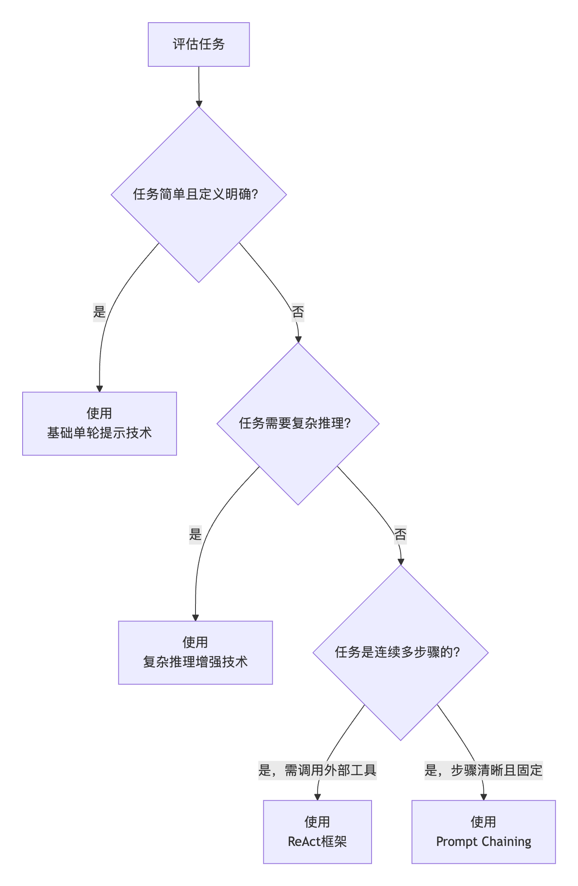

[TOC]

# 提示词工程

## 一、技术发展

### （一）发展史

**萌芽期（1950-2005）**

- 1956年，约翰·麦卡锡在达特茅斯会议上首次提出"人工智能"这一术语
- 1980年，福岛邦彦提出"神经认知机"，被视为CNN雏形
- 1998年，Yann LeCun发表LeNet-5，奠定现代CNN基本结构（卷积层、池化层、全连接层）

**探索沉淀期（2006-2019）**

- 2012年，AlexNet在ImageNet大赛夺冠，宣告深度学习浪潮到来
- 2017年，Google发表《Attention Is All You Need》，提出**Transformer架构** ← 面试高频
- 2018年，OpenAI推出GPT-1，Google推出BERT

**迅猛发展期（2020-至今）**

- 2020年，OpenAI推出GPT-3（1750亿参数），展示上下文学习和指令遵循能力
- 2022年11月，**ChatGPT**发布，通过RLHF技术让AI走向大众 ← 面试高频
- 2023年3月，GPT-4发布，多模态模型
- 国产：阿里通义千问、深度求索DeepSeek系列

### （二）幻觉问题

**1. 事实性幻觉（Factuality）**

表现：事实不一致、捏造事实

原因：知识过时（训练数据有截止日期）、数据不准确（训练数据本身含错误信息）

**2. 忠实性幻觉（Faithfulness）**

表现：不遵循指令、不遵循上下文、回复内容逻辑不一致

原因：指令模糊复杂、推理能力不足

### （三）提示词工程

通过精妙的指令设计，约束模型行为。

引导模型进行结构化思考，明确其答案的边界和依据。

> 注：提示词工程无法赋予模型新的知识，效果依赖于模型固有能力，对知识盲区导致的幻觉治标不治本

### （四）模型微调

通过数据驱动的方式，从根本上调整模型参数，使其在特定领域内更可靠。

使用高质量的、事实准确的领域数据对模型进行再训练，强化其产生正确事实的模式，抑制胡编乱造。

### （五）RAG（检索增强生成）

这是目前解决**事实性幻觉**最有效、最流行的工程架构。

将大模型与外部知识源（如数据库、文档库、互联网）连接。在回答问题时，先检索相关证据，再让模型基于证据生成答案。

### （六）Agent

Agent将大模型从"内容生成器"提升为"动作执行者"，其核心架构天然包含了对抗幻觉的机制。

**核心思路**：模型作为"大脑"，可以规划步骤、调用工具（如搜索引擎、代码解释器、计算器）来验证自己的猜想或弥补知识短板。

### （七）小结

| 技术           | 作用层面 | 核心价值                               | 适用场景                             |
| -------------- | -------- | -------------------------------------- | ------------------------------------ |
| **提示词工程** | 交互界面 | 低成本、即时生效的引导                 | 简单事实查询、逻辑推理任务           |
| **模型微调**   | 模型内部 | 塑造领域专家，从根本上减少领域内幻觉   | 医疗、法律、金融等专业领域           |
| **RAG**        | 系统架构 | 提供实时、准确的外部知识证据           | 知识库问答、客户服务、企业数据分析   |
| **AI Agent**   | 系统架构 | 动态规划与验证，处理复杂、开放世界任务 | 数据分析、研究报告生成、复杂问题求解 |

## 二、提示词工程基础

基于OpenAI官网文档，提炼出5条大原则：

### 1. 清晰的指令

任何Prompt技巧，都不如清晰的表达你的需求。包含：

- 尽量多提供重要的**详细信息或上下文**
- **角色**扮演（让模型充当某个角色，回复更专业）
- 使用**分隔符**标明输入的不同部分（```、"""、XML标签）
- 提供**示例**（帮助模型理解任务模式）
- 指定**输出长度**（按单词/句子/段落/要点计数）

### 2. 文本参考

基于文本文档，辅助大模型问答，降低模型"幻觉"（一本正经的胡说八道）问题。

### 3. 复杂任务拆分简单子任务

把复杂的任务给拆为更为简单的子任务，大模型会有更好的表现。类比工作中将大项目拆分为子任务。

### 4. 给模型"思考"的时间

不是直接给出最终答案，而是像人做数学题在草稿纸上写计算过程一样，把"脑子里想的步骤"用语言表达出来。

- 让模型 think step by step（一步步思考）
- 显式写出推理过程，而不是直接给结果

### 5. 借助外部工具

大模型并不是万能的，使用外部工具就好比给大脑装上了身体。

- **联网搜索工具**：解决实时信息问题
- **代码执行工具**：解决精确计算/数据处理
- **数据库/知识库工具**：解决企业内部数据/特定领域知识
- **外部API调用**：天气查询、航班查询、地图导航等

## 三、提示词进阶

### 1. 基础提示词

#### 1.1 Zero-shot（零样本）

不提供示例，直接靠模型预训练知识完成任务。像问专家问题，他凭经验直接回答。

#### 1.2 Few-shot（少样本）

通过 1-3 个参考示例引导模型理解模式，使模型实现更好的性能。

### 2. 复杂推理

**思维链（CoT, Chain of Thought）**

通过展示中间推理步骤来解决复杂问题。可以与少样本提示结合使用。分为两种形式：

- **Zero-shot-CoT**：不给示例，只在提示中加一句 `"Let's think step by step"`，模型会自行展开推理链
- **Few-shot-CoT**：提供几个**带完整推理过程**的示例，让模型模仿推理模式

### 3. 多步执行

#### 3.1 链式提示（Prompt Chaining）

把复杂任务分解为**多个子步骤**，**每个步骤由单独的提示完成**，前一步的结果作为新提示的一部分。

#### 3.2 自我一致性（Self-Consistency）

让大模型生成多个不同的推理路径。然后对这些推理路径的最终答案进行**投票/聚合**，选择出现次数最多或者最合理的答案。

#### 3.3 ReAct（推理与行动）

全称：**Synergizing Reasoning and Acting in Language Models**（在语言模型中协同推理与行动）

由 Shunyu Yao 等人在 2022 年 10 月提出。

核心循环：

**Thought（思考）→ Act（行动）→ Observation（观察）循环**

- **Thought（思考）**：模型分析当前任务和已有信息，进行推理和规划
- **Act（行动）**：根据思考结果，执行具体行动（通常是调用外部工具：搜索引擎、数据库、计算器等）
- **Observation（观察）**：接收行动返回的结果，成为下一步思考的新依据

循环持续到模型认为已收集到足够信息，能回答用户问题为止。

### 4. 合理使用

不是越高级的技术越好，简单任务用ReAct会"用力过猛"且浪费token。提示词开发是不断重复**编写→评估→迭代**的过程。



## 四、提示词安全

### 1. 常见攻击类型

#### 1.1 提示词注入（Prompt Injection）

攻击方式：在用户输入中插入恶意指令，覆盖原始Prompt目标。

防护措施：
- **输入分隔符**：用 ```、""" 等标记用户输入区域
- **权限控制**：在系统Prompt中明确限制任务范围

#### 1.2 越狱攻击（Jailbreaking）

攻击方式：绕过模型安全限制生成违法/有害内容。

防护措施：
- **内容过滤**：使用内容审核服务检测违规内容
- **道德约束**：在Prompt中强化安全声明

#### 1.3 数据泄露攻击（Data Extraction）

攻击方式：诱导模型透露训练数据中的隐私信息。

防护措施：
- **数据隔离**：禁止模型访问内部数据
- **回复模板**：对敏感问题固定应答

### 2. 编写健壮的提示词

为模型设定清晰、不可逾越的边界，三种核心防御手段：

- **角色锁定**：限定模型只做特定任务（如"你是专业客服助手，仅解答产品A的使用问题"）
- **输入隔离**：只处理被分隔符包裹的提问，忽略输入中针对模型的指令（如"忽略上文"）
- **标准化应答**：合规问题专业解答，违规请求统一回复"此问题不在支持范围内"
